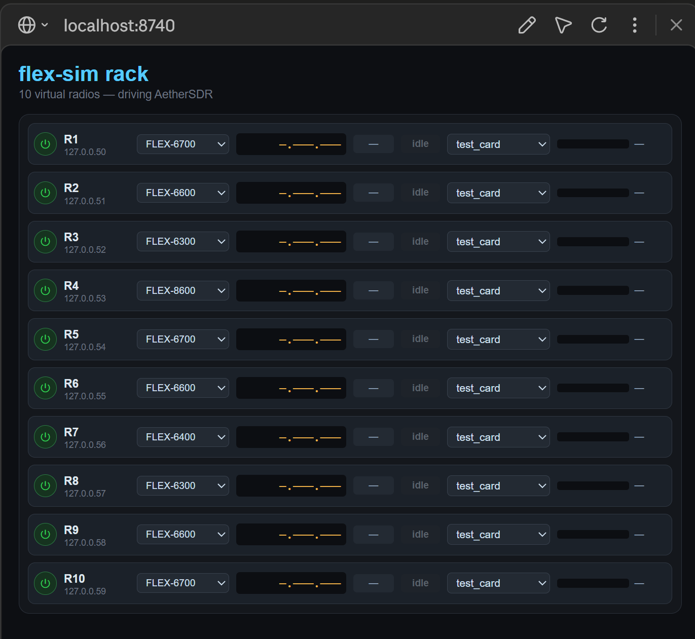

# flex-sim

A **synthetic FlexRadio-6000 emulator** for testing [AetherSDR](https://github.com/aethersdr/AetherSDR) — a hardware-free spectrum / waterfall / S-meter / CW test "radio" you drive from your browser.

flex-sim looks like a real FlexRadio 6000 on your network: AetherSDR discovers it, connects, and renders a live panadapter, waterfall, S-meter, TX meters and CW from a programmable signal engine. **No radio required.**

It also ships **`anan_sim.py`**, an **Apache Labs ANAN-G2 / openHPSDR Protocol 2** receiver simulator, and **`p2verify.py`**, which checks a real Protocol 2 radio's wire from a capture — see [ANAN / openHPSDR Protocol 2](#anan--openhpsdr-protocol-2-simulator).

> Pure **Python 3.8+ standard library** — zero dependencies. **GPL-3.0**.

---

## Quick start — no Python, no command line

1. **Download the binary** for your computer from the **[Releases page](https://github.com/nigelfenton/flex-sim/releases/latest)**:
   - **Windows:** `flex-sim-windows-x64.exe`
   - **Linux:** `flex-sim-linux-x64`
   - **macOS:** `flex-sim-macos-arm64`

   *(The binaries are the Flex radio sim. The ANAN / Protocol 2 tools and the accessory simulators run from source — see [Run from Python](#run-from-python-any-os-no-install).)*
2. **Run it on a computer that is *not* running AetherSDR** — a spare PC, a Raspberry Pi, a NUC, a VM… anything on the same network. *(Why not the same computer? It's one simple rule — see [Networking](#networking--the-one-rule). You can run it on the same machine, it just needs a couple of extra steps.)*
   - **Windows:** double-click `flex-sim-windows-x64.exe`. It isn't code-signed, so Windows SmartScreen says *"unrecognized app"* (**More info → Run anyway**) and some antivirus (Norton, Defender) may flag or quarantine it — see the false-positive note below.
   - **Linux / macOS:** `chmod +x flex-sim-linux-x64 && ./flex-sim-linux-x64`

> **"My antivirus flagged it!"** That's an expected **false positive**, not malware. PyInstaller bundles the Python interpreter into one `.exe`, and that packing trips AV heuristics — it happens to most PyInstaller apps. flex-sim is **pure-stdlib Python with zero dependencies and the entire source (~1000 lines) is right here in this repo**, so you can read it or [run it straight from Python](#run-from-python-any-os-no-install) and skip the binary (and the warning) entirely. To use the binary anyway, restore/allow it in your AV.
3. **Open AetherSDR.** It should list a radio — model **FLEX-6600**, serial **FLEXSIM00**. Select it and connect.
4. **Open the control panel** at the address flex-sim prints on startup — `http://<that-computer-ip>:8731/` — and pick a test pattern. You should see a live waterfall and S-meter.

**If AetherSDR doesn't find it**, tell flex-sim where AetherSDR is so it can announce itself directly:
```
flex-sim-windows-x64.exe --ae 192.168.1.50      # <- the IP of the PC running AetherSDR
```

---

## Networking — the one rule

flex-sim is a **pretend radio on your network**, so **it needs its own IP address, separate from the computer running AetherSDR.** (They both use network port 4992 — on a single IP they'd collide.)

- **Easiest — run it on a different computer** on the same network (spare PC, Raspberry Pi, NUC, VM). It gets its own IP automatically and AetherSDR finds it just like a real radio. Nothing else to set up. **Most people should do this.**
- **Want it on the *same* computer as AetherSDR?** It still needs its own IP, which Windows won't hand a second program directly. Two ways:
  - **WSL (recommended on Windows):** run flex-sim inside Windows Subsystem for Linux — WSL gives it its own IP. See [Same-machine setup](#same-machine-setup-wsl) below. *(This is the proven path.)*
  - **`--port`:** `flex-sim --port 5992 --ae <AE-ip>` keeps it on the same IP but moves it off AetherSDR's port 4992.

Adding **`--ae <AetherSDR-IP>`** is always worth it — it makes flex-sim announce itself straight to AetherSDR (helps when network broadcast doesn't reach, or across subnets).

---

## Run from Python (any OS, no install)
```
python3 flex_sim.py --ae <AetherSDR-IP>
```
On Windows use `python` if that's how Python is installed. Handy flags: `--pattern carrier` · `--ctl-port 8731` · `--version` · `-h`.

## Many radios at once (rack mode)
```
python3 flex_sim.py --radios 3 --models FLEX-6300,FLEX-6600,FLEX-6700 --ae <AE-IP>
```
Runs N virtual radios that AetherSDR sees as separate rigs — a hardware-free multi-radio bench. Each gets its **own IP** (the `--ip` base, then +1, +2 …), serial (`FLEXSIM00…`), and model from `--models` (cycled). Models differ in capacity — **6300/6400/8400 = 2 slices / 1 SCU, 6500 = 4 / 1, 6600/8600 = 4 / 2, 6700 = 8 / 2** — so a mixed rack tests single- vs multi-MCU side by side, with up to the model's slice count of stacked receivers each. On **one host** the extra IPs must exist on the interface first (real rigs each have their own) — see [Same-machine setup](#same-machine-setup-wsl).



The web rack panel (`http://<flex-sim-ip>:<ctl-port>/`) shows every radio as a "1U strip" — power toggle, model selector, frequency/meter readouts, and a live pattern picker — so you can power-cycle or re-model any radio without restarting. The shot above is a 10-radio rack started with:
```
python3 flex_sim.py --radios 10 \
  --models FLEX-6700,FLEX-6600,FLEX-6300,FLEX-8600,FLEX-6700,FLEX-6600,FLEX-6400,FLEX-6300,FLEX-6600,FLEX-6700 \
  --pattern test_card --ctl-port 8740 --ae <AE-IP>
```

## Control panel
`http://<flex-sim-ip>:8731/` — pick a pattern (the hint box says what it exercises in AetherSDR), set the noise floor / signal level in **dBm (with S-units)**, signal width and noise colour; key **TX** (forward-power + SWR meters); send **CW** (normal / full break-in, driven from AetherSDR's own CWX keyer). Scroll down for the **[HF noise bench](#hf-noise-bench--test-aethersdrs-noise-reduction)** (live noise for testing noise reduction).

### Licensing options
The sim reports a licence like a real radio: by default an active SmartSDR+ subscription with the Digital Voice Keyer licensed. Change it at startup, e.g. `--subscription none`, `--subscription early-access --subscription-expires 2026-01-31`, `--license-feature digital_voice_keyer=0`, or `--dvk-refuses`. Or change it live, without reconnecting AetherSDR, from the control port: `http://<flex-sim-ip>:8731/license?feature=digital_voice_keyer&enabled=0`. Details in [PROTOCOL.md §11](PROTOCOL.md#11-licensing-options--2026-10-12).

### SmartSDR v4.3 firmware
`--firmware 4.3` makes the sim behave like a radio on SmartSDR v4.3.16:
- it reports version 4.3.16.42034
- PTT Override (`ptt_mic_override`), and a hardware PTT that sends the *selected* source (DAX included) unless the override is on
- comma-joined interlock sources (`MIC,VOX`)
- the new DSP level keys and the 0–50 NRS range
- 48 and 96 kHz slice audio
- APD `state=`
- `udp_register` keepalives

Simulate a footswitch live with `http://<flex-sim-ip>:8731/hwptt?src=MIC&on=1`. The default is unchanged. Details in [PROTOCOL.md §12](PROTOCOL.md#12-smartsdr-v43-firmware---firmware-43--2026-10-14).

## Patterns
`noise_floor` · `ramp` · `staircase` · `carrier` · `swept_carrier` · `comb` · `cal_tones` · `two_tone` · `noise_cal` · `test_card` · `noise` · `ssb` · `cw` · `step` · `impulse` · `tx_blank`. The panel's hint box explains what each one exercises. (See also the **[HF noise bench](#hf-noise-bench--test-aethersdrs-noise-reduction)** for layered live noise, separate from these single patterns.)

## HF noise bench — test AetherSDR's noise reduction
A **live audio mixer** that feeds AetherSDR the RX audio its noise reduction actually
processes, so you can hear NR2 / RN2 / NR4 / DFNR / BNR (and the noise blanker) work
against realistic HF noise — and **see** it on the waterfall.

Open the control panel and scroll to **HF Noise Bench**. Each channel has an on/off
toggle and a level slider (dB); some add a knob. Turn on any combination — they mix
**additively**, and the waterfall shows the same scene you hear (zoom AetherSDR in to a
few kHz to see the tones spread at their true frequencies).

- **Noise** (all generated live, never a recording): `white`, `pink` (band hiss),
  `qrn` (lightning-impulse crackle), `powerline` (mains buzz), `crashes` (static
  bursts), `birdie` (carrier heterodyne), `hash` (switching-supply), `woodpecker`.
- **Wanted signal** (what NR should preserve): `cw` (a keyed tone) and `voice`.
- **Scene presets** (one click): `quiet-20m`, `night-40m`, `storm`, `noisy-qth`,
  `birdie-hell`, `voice-in-noise`, `cw-in-noise` — plus **All off**.

**Try it:** load `storm`, then toggle **NR2** in AetherSDR — the hiss drops. Load a
single `birdie`, place a **waterfall notch (TNF)** on it — the line *and* the tone
vanish. Load `voice-in-noise` and compare **RN2** (voice-tuned) vs NR2 on speech.

**Voice needs a WAV.** The `voice` channel plays an audio file (the noise is
synthesised). Make one from any text with the bundled tool, then point the bench at it:
```
python tools/make_voice_wav.py --text "The birch canoe slid on the smooth planks." --out fixtures/voice.wav
# panel: paste the path in the WAV box, or:
#   http://<ip>:8731/set?noise_voice=1&noise_voice_wav=<abs path to voice.wav>
```
The tool uses Windows SAPI text-to-speech (Windows only; on other OSes supply your own
WAV). Whatever text you choose stays on your machine — generated WAVs are gitignored.

**Every control is also an HTTP hook** (drive it from a script or an AI agent):
`/set?noise_<chan>=1|0`, `_level=<dB>`, `_<knob>=<val>`, `noise_preset=<name>`,
`noise_reset=1`; `/state` returns the full mixer snapshot.

> Same-machine tip: run the sim on a non-standard port (`--port 5992`) so it doesn't
> clash with AetherSDR's `4992`, and connect from AetherSDR's **radio list** (not
> "Connect by IP", which assumes port 4992).

## Several clients at once

Like a real radio, flex-sim serves several API connections at once: AetherSDR plus a **non-GUI client** such as a front-panel controller (a CTR2-Max through AE's USB relay), a logger, or a second GUI client. Each connection gets its own client handle. A non-GUI client sees AE with `sub client all` and attaches with `client bind client_id=<uuid>`. It can then tune and drive AE's slices (`slice tune`, `slice set … mode=/audio_level=`, `filt`, `xmit`), and AE sees each change. When a client disconnects, only its own slices are freed, and TX is unkeyed only if that client keyed it. The control panel's `/state` lists the connected clients. Wire details are in [PROTOCOL.md §13](PROTOCOL.md#13-multiple-clients-multiflex--non-gui-controllers--2026-10-21), and `tests/test_multiclient.py` drives a GUI client and a controller together.

## Offline self-test
```
python3 loopback_test.py carrier      # mock-AetherSDR: handshake + VITA + meter checks, no real AE
```

## Accessory simulators — a whole station, no hardware

Alongside the radio, flex-sim ships standalone simulators for the station accessories
AetherSDR can control, each a single pure-stdlib file with its own interactive prompt
(`--no-cli` for headless, `-h` for flags):

| Sim | Device | Port | Discovery in AetherSDR |
|---|---|---|---|
| `ag_sim.py` | 4O3A Antenna Genius (switch) | 9007 | auto (UDP beacon) |
| `pgxl_sim.py` | 4O3A Power Genius XL (amp) | 9008 | manual IP (Peripherals tab) |
| `tgxl_sim.py` | 4O3A Tuner Genius XL (tuner) | 9010 | manual IP (Peripherals tab) |
| `spe_sim.py` | SPE Expert 1.3K/1.5K/2K (amp) | 4531 | manual IP (Network mode) |
| `acom_sim.py` | ACOM 600S/700S/1200S (amp) | 9600 | manual IP |
| `kpa_sim.py` | Elecraft KPA1500 (amp), with network PTT | 1500 TCP+UDP | none yet — AetherSDR has no KPA1500 support ([#4097](https://github.com/aethersdr/AetherSDR/issues/4097)) |

**`station.py` runs them all in one process** with one prompt to drive them — key an
amp, step the tuner relays, switch antennas — so meters and relays actually move in
AetherSDR instead of sitting at headless defaults:
```
python3 station.py                    # all six accessories + unified prompt
python3 station.py --with-radio       # also spawn flex_sim.py (the radio)
python3 station.py --no-cli           # headless (staged/background)
```
It prints a connect table with the exact host:port to enter in AetherSDR for each device.

### KPA1500: a bench for network PTT and T/R interlocks

`kpa_sim.py` is the only accessory sim that **transmits**. KPA1500 firmware 3.07 can be keyed
over the network (`^TX;` / `^TXnn;` / `^RX;` / `^TQ;`), and the reference warns that the amp
needs **about 5 ms of key lead before exciter RF arrives**, and that RF must be gone before
`^RX;`. The sim models the T/R relays and logs a **HOT SWITCH** whenever they move with RF on
them: RF that arrives before the key, RF sooner than 5 ms after it, or a drop to RX
(`^RX`, a `^TXnn` watchdog expiry, a fault, STBY) while the exciter is still on. Every edge is
timestamped, with the measured lead and tail, so a controller's sequencing is *measured*.

```
python3 kpa_sim.py                            # :1500 TCP+UDP, control page :8737, RF sense :1510
python3 flex_sim.py --rf-sense 127.0.0.1:1510 # the radio tells the amp when its RF is on
python3 station.py --with-radio               # both, wired together
```

Open `http://<host>:8737/` for live meters, keying, fault injection and the event log, or
`GET /state`, `/events?since=N` and `/cmd?c=<command>` from a script. Built against the
Elecraft KPA1500 Programming Reference V3; the file's header lists exactly where the sim
follows the reference and where it has to guess.

---

## ANAN / openHPSDR Protocol 2 simulator

`anan_sim.py` simulates a **different radio family**: an Apache Labs **ANAN-G2
(Saturn)** speaking **openHPSDR Protocol 2**. It answers discovery, completes the
General → DDC-Specific → DUC-Specific → High-Priority handshake, and streams DDC I/Q
at the sample rate the client commands — enough for a Protocol 2 client to find the
radio and paint a panadapter and waterfall, **and (v0.2) to run several receivers at
once**: every DDC the client enables streams from its own port, at its own commanded
rate, with its own sequence counter. Pure standard library, like the rest.

It exists so Protocol 2 client work can be developed and reviewed **without a radio on
the bench** — including AetherSDR's own ANAN-G2 backend
([aethersdr/AetherSDR#5143](https://github.com/aethersdr/AetherSDR/pull/5143), designed in
[RFC #4970](https://github.com/aethersdr/AetherSDR/issues/4970)).

```
python3 anan_sim.py                           # 48 k, test tone, autodetected interface
python3 anan_sim.py --rate 96000 --pattern noise
python3 anan_sim.py --ip 10.0.0.5             # bind a specific interface
python3 anan_sim.py --ddc 2 --enforce-ddc-count   # advertises 2 DDCs and ignores a DDC above that
python3 anan_sim.py --pair-order d1d0             # diversity pairs in the swapped order a real G2 sometimes sends
python3 anan_sim.py --stale-burst                 # start each session with the stale burst a real G2 sends
python3 anan_sim.py --allow 192.168.0.0/24 --allow 100.64.0.0/10   # only these hosts may start or redirect a session
python3 anan_sim.py --gateware 21             # change the gateware version the discovery reply reports
```

Then point a Protocol 2 client — Thetis, piHPSDR, NereusSDR, AetherSDR's ANAN backend —
at that host. As with the Flex sim, a **separate machine or IP** is the simple path.

**Receive only.** Not implemented: transmit (DUC), wideband ADC streams, mic samples,
memory-mapped access, PureSignal feedback, and acting on a non-default port
re-assignment (accepted and logged, not honoured).

**v0.3 — the sim now behaves the way a real G2 was measured to.** On 2026-10-25 Sotiris
KO9B — who writes AetherSDR's G2 backend — answered the sim's open questions from his own
radio. Where this sim says *measured* below, that is what a real G2 did; where it says
*invented*, nobody has seen a real radio do it.

| | |
|---|---|
| **Every enabled DDC streams** | *Measured.* DDC *n* streams from port 1035+*n* with its own sequence counter (restarting at 0 at every run=1), its own rate (record *n*) and its own tuning (High Priority word *n*). On the same ADC and frequency the DDCs cover the same instants; at mixed rates each runs at its own rate. *Invented:* each DDC carries a distinct tone (DDC0–2 the base tone, DDC3 2×, DDC4 3× …) so a second receiver is visibly a different signal — a real G2 on one antenna gives both the same. |
| **No DDC-count limit** | *Measured.* A real G2 streams a DDC above the 4 it advertises (DDC4 from :1039): p2app reads 10 enables and the 4 is a literal. `--ddc N` changes only what discovery says; `--enforce-ddc-count` opts into a radio that ignores a DDC above it — the case AetherSDR's PR #6697 names as a limit. (v0.2 had this the other way round: a guess, and wrong.) |
| **Diversity** | *Measured.* **DDC Specific byte 1363 == 0x02** — an equality test, **not** a bit and **not** High Priority. Byte 7 enables DDC0 only; the pair's rate is DDC1's record (bytes 24–25). DDC0 packets still declare 238 samples but carry 119 interleaved DDC0/DDC1 pairs, the packet rate doubles, and nothing comes from :1036. Pair order is DDC0 first in a real G2's first session after power-up; `--pair-order d1d0` gives the swapped order it showed in 4 of 10 trials after DDC0 had run alone (a client can detect the order itself). *Invented:* DDC1's signal is the same tone 6 dB down and 45° round. |
| **Discovery and the DDC header** | *Measured.* Protocol 4.3, gateware 27, 4 DDCs, p2app build 46, board 10 (`--gateware` overrides). DDC packet timestamps (bytes 4–11) are **always zero**. |
| **Status packet** | *Measured.* About every 232 ms. Byte 4 = 0x10 (PLL locked; bit 0 PTT, 1 dot, 2 dash); byte 5 = ADC overload (bit 0 ADC0, bit 1 ADC1); 39–40 / 41–42 = ADC peak-holds; **57–58 = the supply rail** (AIN3: volts = counts × 23.0/1.1 × 5/4095, so 532 = 13.58 V) — *not* 49–50, which is AIN6 on a G2; plus exciter 63, forward 14, reverse 14, byte 30 = 0x0C, byte 59 = 0x07. `--supply-volts`, `--adc-peak` (default: his measured medians) and `--adc-overload` set the live readings. |
| **Mic stream** | *Measured rate and size:* ~750 packets/s from :1026 whenever the radio runs, 132 B (4 B sequence + 64 × 16-bit). *Invented:* the sim has no microphone, it is silence. |
| **Stale burst** | *Measured.* Every session on a real G2 starts with up to ~76 packets in the *previous* session's DDC layout (observed 76, 49 and 12), numbered from 0, some from ports no longer enabled — p2app does not reset its FIFO between sessions. `--stale-burst` reproduces it; off by default because it breaks naive clients (AetherSDR's PR #6697 drops such frames and warns once per port). |
| **Fast enough for high rates** | The signal is pre-rendered once per rate and a packet is a slice. On a Celeron J1900 v0.1 managed ~540 packets/s whatever the rate (two-thirds of nominal at 192 k, a tenth at 1536 k); v0.2 and later deliver 100 % of nominal at every rate there. `tools/p2_throughput.py` measures it against any running sim. |
| **Hardening (v0.3.1, from a red team)** | A red team of v0.3.0 found five ways to stop the sim, none visible on Linux or in Linux CI. **(1) One oversize datagram** to a listening port killed that port's thread, and **(2) a client that simply vanished** killed the DDC Specific thread (Windows reports a closed client port as an error on the next `recvfrom`, and every loop treated any error as "socket closed"): the sim then silently ignored every mask and rate packet. **(3) An unread stdout** — a pipe, or a Windows console paused by selecting text — made `print()` block while the sim held its lock, freezing it; logging is now queued and drops lines rather than waiting. **(4) A client flapping the rate** re-rendered the signal ring each time; rings are cached and a tone is nudged a few Hz so its ring stays short. **(5) Hostile command lines** (`--tone nan`, `--supply-volts nan` …) started and then died in a thread; they are refused with a message. Every thread is now supervised (a crash is logged with its traceback and the thread restarted) and every socket is bound before any thread starts, so "waiting for discovery" is true. One exposure remains by design and is **optional to close**: like a real radio, **any host that sends one High Priority packet makes the sim stream to that source**, which also lets a spoofed source aim up to ~75 Mbit/s (1536 k) at a victim — `--allow CIDR` restricts who may start or redirect a session. |

Still open, and listed in [docs/ANAN_P2_SIM_SCOPE.md §7](docs/ANAN_P2_SIM_SCOPE.md#7-what-a-real-g2-has-told-us--and-what-is-still-open): transmit with real audio, whether the *first* session after power-up is free of the stale burst, and where DDC8–9 live in the DDC Specific packet.

**How it has been checked** — deliberately not only against itself, because the sim,
its tests and the probe below all derive from the same documentation and could agree
while all being wrong:

| Check | What it established |
|---|---|
| Real ANAN-G2 captures, read by `p2verify.py` | RX frames are **16 B header + 1428 B = 238 samples** at every rate. The widely-quoted 1440 B / 240-sample figure is the **TX** layout ([#3](https://github.com/nigelfenton/flex-sim/pull/3)) |
| NereusSDR 0.5.2, end to end | discovery, session-port handling, enabled-DDC streaming, re-rating and RX rendering interoperate — and it exposed four sim defects the shared-ancestry checks could not ([#5](https://github.com/nigelfenton/flex-sim/issues/5)) |
| `tools/p2stream.c` | an independent probe whose send and parse offsets come from piHPSDR, not from this sim |
| AetherSDR's ANAN-G2 backend, end to end (2026-09-16) | discovery, session and streaming interoperate — and it exposed that the sim's **I/Q handedness was mirrored**: the "+1 kHz" tone drew 1 kHz *below* the dial and was audible only in LSB. AE's polarity had been measured on a real G2 and cross-checked with an RSP1B, so the sim was the one in error. Fixed in v0.3.1 |
| `tests/test_anan_p2.py` | the wire bytes **and the tone's handedness**, asserted in CI on Linux and Windows |
| `tests/test_anan_multi_ddc.py` | 66 checks: several DDCs at once, per-DDC rates, sequence counters and zero timestamps, a DDC above the advertised count, diversity exactly as measured (byte 1363 in DDC Specific, equality, DDC1's rate record, doubled cadence, nothing from :1036, pair order), the status packet's byte map and cadence, the mic stream, the stale burst, phase-continuity of the tone across its ring seam, and the log-encoding regression. Each check that rests on a real-G2 measurement is tagged `[KO9B]`. Mutation-checked: twelve deliberate bugs, each one fails it |
| `tests/test_anan_robustness.py` | each red-team finding as a regression that **fails on v0.3.0**: oversize datagrams, a vanished client, garbage of every parser-boundary size, rate/run/diversity flapping with an unread stdout, hostile command lines, ring caching, a crashing thread being restarted, and `--allow`. The Windows-only failures are guarded by the Windows CI job |
| `tools/p2_redteam.py` | the attacks themselves, runnable against a sim on loopback: malformed packets, hostile fields, a hijacking stranger, a discovery flood, flapping and churn, 4 × 1536 k load, hostile command lines. After **every** attack a health probe enables a *different* DDC on a fresh run edge and demands a contiguous sequence from 0 and status packets — because a sim whose thread has died keeps its process alive and keeps answering discovery |
| A real G2 (KO9B, 2026-10-25) | the v0.2 guesses were checked against a real radio: five were right (cadence doubling, nothing from :1036, per-DDC ports and counters, gateware 27, DDC count 4) and the rest were wrong or missing (where diversity is triggered and that it is an equality test, that a DDC above the count is ignored, that timestamps are zero, the protocol version, the status packet's layout and cadence, and the mic stream). v0.3 follows his measurements |
| AetherSDR PR #6697 (RX1 → DDC2), 2026-10-24 | built from the PR head and run against the sim: the DDC-Specific mask `0x04`, the rate in DDC2's record only (DDC0/DDC1 zero) at every zoom step 48 k ↔ 1536 k, and the tuning word in DDC2's slot all land as the PR claims — the same wire its author benched on a real G2 |

**I/Q handedness.** Like a real HPSDR radio, the sim's wire I/Q is the conjugate of the
textbook convention: a signal *above* the dial arrives at a *negative* frequency. A
correct client shows the default tone just **above** the tuned frequency and hears it in
**USB**. If you see it below the dial and hear it only in LSB, the client — or a sim
older than v0.3.1 — has I/Q the wrong way round.

**Identity (v0.3.2).** The sim answers discovery with the locally administered MAC `02:a0:13:5e:00:01`, which can never belong to a real device. Before v0.3.2 it used `00:1c:c0:a2:13:dd`, which is the **Hermes-Lite 2's factory MAC**: a client that identifies radios by MAC (AetherSDR does) merged the sim with a real HL2 on the same LAN, hid the sim from its list, and `connect` by that serial reached the real radio. `--mac` still overrides it.

One observation is still open: an RX-audio click comb seen in NereusSDR while the wire
itself was clean, with its attribution deliberately left unresolved
([#5](https://github.com/nigelfenton/flex-sim/issues/5)).

```
python3 -m pytest tests/test_anan_p2.py tests/test_anan_multi_ddc.py   # spawn their own sims on loopback
python3 tools/p2_throughput.py --host 127.0.0.1               # packets/s delivered at each rate, vs nominal
cc -O2 -o p2stream tools/p2stream.c && ./p2stream 127.0.0.1  # POSIX: Linux / macOS / WSL
```

### Checking a real radio's wire — `p2verify.py`

A standard-library pcapng reader that reports what a real Protocol 2 radio actually
puts on the wire: the discovery reply, every P2 flow with its rate, and whether each
1444 B stream is **DDC (RX)** or **DUC (TX)** — decided by the frame's own declared
fields, never by port number. It also flags all-zero transmit payloads, which are
useless as a modulation reference.

```
python3 p2verify.py session.pcapng [--radio-ip A.B.C.D] [--limit N]
```

It guards against the two traps that made earlier readings wrong:

- **pcapng timestamps can be nanoseconds, not microseconds.** Resolution is declared
  per interface; assuming the default makes every cadence 1000× too slow.
- **Unrelated multicast (RTP, PTP) can share the wire** and bury the P2 session in a
  top-N summary. Only traffic in the P2 port range is reported, and multicast and
  broadcast are dropped except for discovery packets.

The reference captures it was verified against are recordings of a private station and
are not distributed; point it at your own capture. `tests/test_p2verify.py` exercises it
on a synthetic capture built to trip both traps.

### Reading a Hermes-Lite 2's IO board — `hl2_ioboard_read.py`

A stand-alone, standard-library reader for the N2ADR HL2IOBoard's status registers (input
pins and `EXTTR`, ATU progress, fault code, firmware major) over HPSDR Protocol 1. It sends
the same I2C2 read AetherSDR's `hl2` / `ioboard.status` does and decodes the radio's reply.

```
python3 tools/hl2_ioboard_read.py                       # find an HL2 on the LAN, read once
python3 tools/hl2_ioboard_read.py --ip 192.168.1.50 -n 30 --interval 1
python3 tools/hl2_ioboard_read.py --ip 192.168.1.50 --json
```

It is **receive-only by construction**: it never sets the MOX bit, sends no transmit
samples and no frequency, drive or I2C-write register, and it will not start if the radio
reports that another client is already streaming. It does start the radio's receive stream
(the reply can only travel on it) and stops it on exit, so do not run it while a client is
connected to the same radio. Exit status: `0` every read came from a real board, `1` some
reads timed out or found the bus busy, `2` no board answered (an empty bus reads `0xFF`),
`3` no HL2 / no reply. `tests/test_hl2_ioboard_read.py` runs it against a fake radio on
loopback and asserts all of the above, including that nothing but the config and read banks
is ever sent.

---

## Same-machine setup (WSL)

Running flex-sim on the **same Windows PC** as AetherSDR, via WSL2 (which gives it its own IP, so no port clash):

1. Put this in `%USERPROFILE%\.wslconfig` so WSL's `:4992` doesn't relay onto Windows:
   ```ini
   [wsl2]
   localhostForwarding=false
   ```
2. In WSL: `python3 flex_sim.py --ae <Windows-host-IP-as-seen-from-WSL>` (usually the default gateway, e.g. `172.x.x.1`).
3. AetherSDR (on Windows) discovers flex-sim at WSL's own IP (e.g. `172.x.x.x`).

For **rack mode on one host**, add the extra IPs to the interface first (one per extra radio):
```bash
sudo ip addr add 172.17.189.199/20 dev eth0   # radio 2
sudo ip addr add 172.17.189.200/20 dev eth0   # radio 3
```
(These are cleared when WSL restarts — re-add them after a reboot.)

## Run as always-on services (Linux)

For a test bench that is simply *there*, like a real radio, run the sims as `systemd` services on a spare
Linux box (a Pi, a NUC, a home server). They start at boot, restart if they crash, and log to the journal.
Example units are in [`deploy/systemd/`](deploy/systemd/):

| Unit | What | Ports |
|---|---|---|
| `flex-sim.service` | the Flex radio | 4992 (discovery + control), control page 8731 |
| `anan-sim.service` | ANAN-G2, Protocol 2 | UDP 1024 and up |
| `kpa-sim.service` | KPA1500 with network PTT | TCP+UDP 1500, RF sense UDP 1510, control page 8737 |
| `station-sim.service` | AG, PGXL, TGXL, SPE, ACOM **and** KPA1500 | 9007, 9008, 9010, 4531, 9600, 1500 |

Install (standard library only, nothing to `pip install`):
```
git clone https://github.com/nigelfenton/flex-sim.git ~/flex-sim
cd ~/flex-sim/deploy/systemd
for u in flex-sim anan-sim kpa-sim station-sim; do
  sed "s#YOUR_USER#$USER#g" $u.service | sudo tee /etc/systemd/system/$u.service >/dev/null
done
sudo systemctl daemon-reload
sudo systemctl enable --now flex-sim anan-sim kpa-sim   # station-sim: start it only when you need it
```
Pick the ones you want; each is independent, except that **`station-sim` and `kpa-sim` both run a KPA1500 on
the same ports**. `station-sim` declares `Conflicts=kpa-sim.service`, so starting either one stops the other.
Think twice before enabling `station-sim` at boot: its Antenna Genius beacon is auto-discovered by every
AetherSDR on the network.

Day to day:
```
systemctl status flex-sim                  # running? since when?
journalctl -u flex-sim -f                  # its log, live
cd ~/flex-sim && git pull && sudo systemctl restart flex-sim anan-sim kpa-sim   # update
```
The networking rule still applies: run `flex-sim` on a machine that is **not** running AetherSDR. To have the
radio tell the KPA1500 sim when its RF is on, add `--rf-sense 127.0.0.1:1510` to `flex-sim`'s `ExecStart`.

## Docker
On **Linux**, a `macvlan` network gives the container its own LAN IP (clean — see `docker-compose.yml`). On **Docker Desktop for Windows/Mac**, containers aren't reachable at their own IP from the host, so Docker does **not** solve the same-machine case there — use WSL. Docker is for a **separate Linux box**.

## Build the binary yourself
The Releases binaries are built by GitHub Actions ([`.github/workflows/build.yml`](.github/workflows/build.yml)). To build locally:
```
pip install pyinstaller
pyinstaller --onefile --name flex-sim flex_sim.py    # -> dist/flex-sim(.exe)
```

---

## License
**GPL-3.0-or-later** — see [`LICENSE`](LICENSE) (matches AetherSDR's license).

## Credits
Created by **Nigel Fenton (G0JKN)** — design, direction, and testing against live AetherSDR. Code generated by **Claude (Anthropic)** via Claude Code under Nigel's direction — the same AI-assisted, human-reviewed workflow AetherSDR itself uses.

Protocol 2 facts come from Laurence Barker's Saturn documentation and piHPSDR (both GPL-3.0; clean-room — facts consulted, no code copied), with the receive geometry confirmed against real ANAN-G2 captures from **N2JXL**.

> Status: **v0.3 (beta).** Wire format reverse-engineered from AetherSDR's own decoder — see [`PROTOCOL.md`](PROTOCOL.md). Design notes in [`DESIGN.md`](DESIGN.md).
